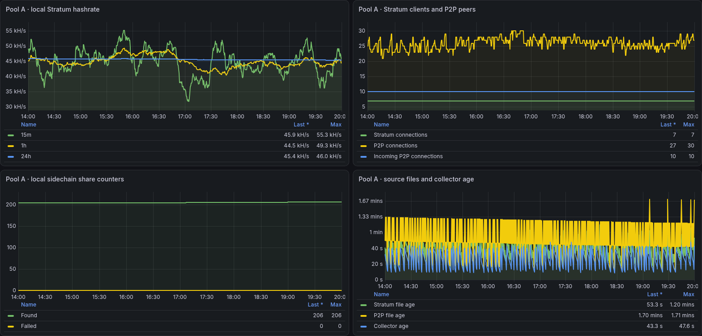

# How we monitor P2Pool with Grafana: configuration examples

Configuration files and examples from [How we monitor P2Pool with Grafana](https://monero.love/guides/p2pool-monitoring/) on monero.love.

## Screenshots and charts

Recorded Grafana views of Pool A on November 4, 2026, from 14:00 to 20:00 UTC. The public article uses a neutral node name. The screenshots show the production monitoring view, which includes more fields than the small collector supplied here.

[](docs/screenshots/p2pool-overview.webp)

Four views of the same six-hour interval. Each image opens at full resolution. Hashrate, connections, share counters and file age answer different questions.

[View all 8 images and captions](SCREENSHOTS.md).

## Files

| File | Origin |
| --- | --- |
| `ARTICLE-EXAMPLES.md` | verbatim fenced source examples |
| `BUNDLE-README.md` | verbatim public download asset |
| `p2pool-collector.py` | verbatim public download asset |
| `p2pool-data-api.args` | verbatim code block |
| `p2pool-monitor.service` | verbatim public download asset |
| `p2pool-monitor.timer` | verbatim public download asset |
| `queries.promql` | verbatim query blocks |
| `test_collector.py` | verbatim public download asset |

## Setup

Follow [BUNDLE-README.md](BUNDLE-README.md) for service accounts, API-file permissions, textfile paths, timer setup and the shared monitoring components. `p2pool-data-api.args` is a reminder of arguments to append to your existing P2Pool invocation. It is not an input file accepted by P2Pool. Preserve your wallet, daemon, sidechain and networking settings.

The collector reads local JSON files and exports selected numeric fields. It does not serve private API files over HTTP. `queries.promql` holds separate expressions to paste individually into Prometheus or Grafana. The tests use synthetic data and do not contact a miner. The original bundle has not been deployed end to end on a fresh installation.

## Checks

Run the relevant commands from this repository after installing the corresponding tools. Some daemon checks require the completed installation paths and your own credentials. See `VALIDATION.md` for what was actually checked while packaging these files.

```sh
python3 -m unittest -v test_collector.py
```

## Source and migration

`SOURCE.json` records the article source revision and file hashes. The files contain examples and placeholders, not production credentials or private infrastructure exports. Generated keys and local secrets belong outside Git.

This is a standalone Git repository. To copy it to an empty GitHub repository you own, substitute your account in these commands:

```sh
git remote add github git@github.com:YOUR_GITHUB_USER/monero-love-p2pool-monitoring.git
git push -u github main
```

Keep the Hyve remote if you want both copies. These commands do not create the GitHub repository or transfer issues and repository settings.
