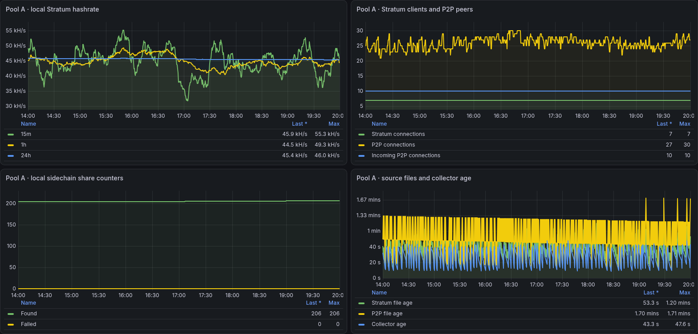
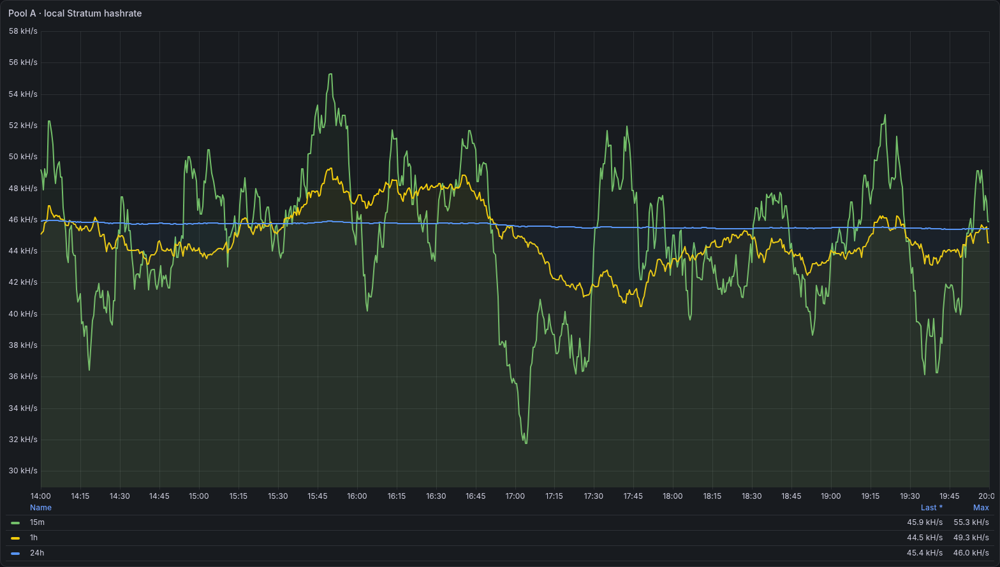
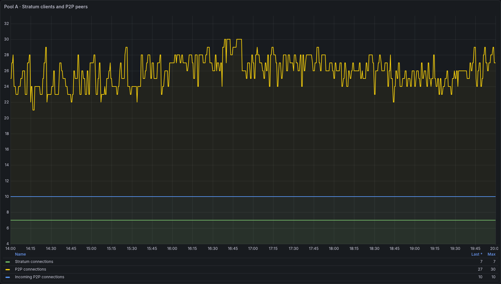
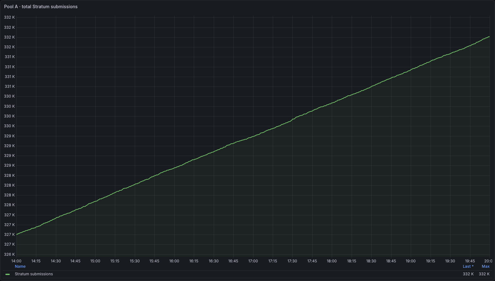
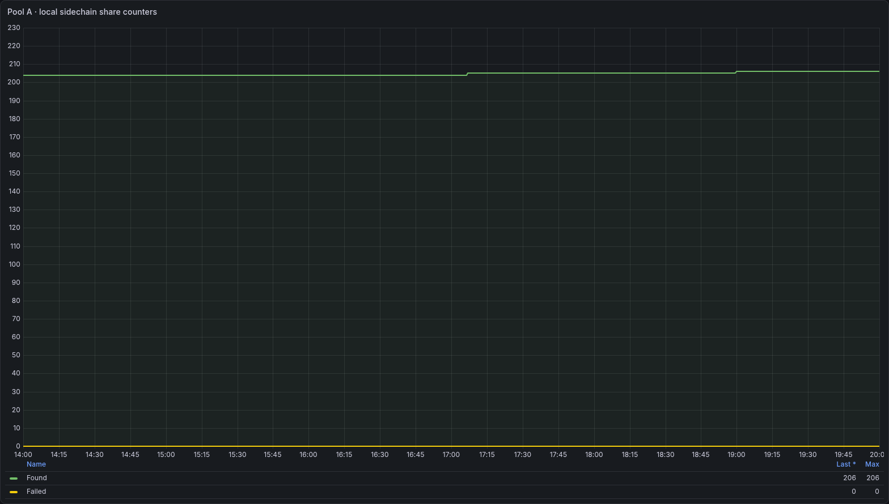
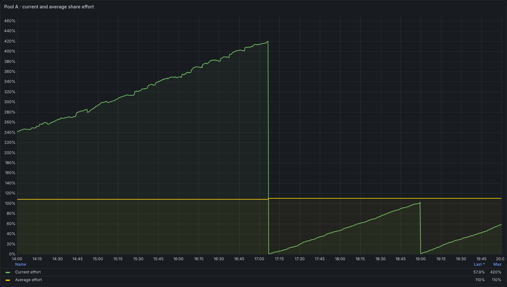
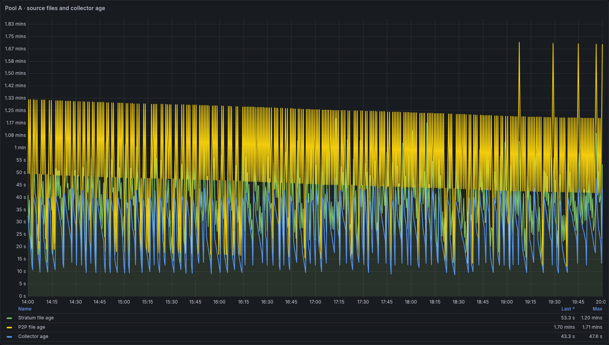
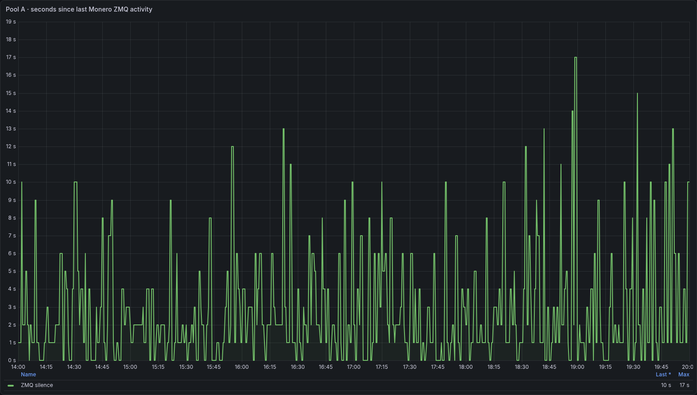

# Screenshots and charts

Recorded Grafana views of Pool A on November 4, 2026, from 14:00 to 20:00 UTC. The public article uses a neutral node name. The screenshots show the production monitoring view, which includes more fields than the small collector supplied here.

Select an image to open the original WebP at full resolution. The files are unchanged copies of the published monero.love assets.

## overview of P2Pool local hashrate, connections, sidechain shares and data freshness

Four views of the same six-hour interval. Each image opens at full resolution. Hashrate, connections, share counters and file age answer different questions.

[Source article](https://monero.love/guides/p2pool-monitoring/) · [Published image](https://monero.love/images/p2pool-overview.webp)

## P2Pool local hashrate estimates over 15 minutes, one hour and 24 hours

The 15-minute estimate varies much more than the 24-hour estimate. The vertical scale starts around 30 kH/s, not zero. That makes the changes easier to see but visually enlarges their proportion.

[Source article](https://monero.love/guides/p2pool-monitoring/) · [Published image](https://monero.love/images/p2pool-local-hashrate.webp)

## separating P2Pool Stratum connections from total and incoming P2P connections

Seven Stratum connections remain present while the total peer count moves between roughly 21 and 30. Incoming peers are included in the total, so do not add those two lines together.

[Source article](https://monero.love/guides/p2pool-monitoring/) · [Published image](https://monero.love/images/p2pool-connections.webp)

## the cumulative Stratum submission counter on the selected P2Pool node

The Stratum counter rises steadily. It describes local submission activity, not a count of Monero blocks or payouts.

[Source article](https://monero.love/guides/p2pool-monitoring/) · [Published image](https://monero.love/images/p2pool-stratum-submissions.webp)

## P2Pool sidechain shares found and failed, showing found increasing from 204 to 206

The found counter moves from 204 to 206 during this interval. That is an increase of two, not 206 shares found in six hours. The failed counter stays at zero.

[Source article](https://monero.love/guides/p2pool-monitoring/) · [Published image](https://monero.love/images/p2pool-sidechain-shares.webp)

## current P2Pool share effort rising above 400 percent and then resetting, beside average effort

Current effort rises above 400% before dropping near 17:00, then rises and drops again near 19:00. Compare those drops with the increments in the share counter.

[Source article](https://monero.love/guides/p2pool-monitoring/) · [Published image](https://monero.love/images/p2pool-share-effort.webp)

## comparing the ages of P2Pool Stratum and P2P JSON files with the monitoring collector age

The collector, Stratum file and P2P file have different update patterns. Grafana displays the longer durations in minutes even though the queries return seconds.

[Source article](https://monero.love/guides/p2pool-monitoring/) · [Published image](https://monero.love/images/p2pool-data-freshness.webp)

## elapsed seconds since P2Pool last observed Monero daemon ZMQ activity

The sampled ZMQ-silence values remain below 20 seconds here. This measures time since observed daemon activity, not peer latency.

[Source article](https://monero.love/guides/p2pool-monitoring/) · [Published image](https://monero.love/images/p2pool-daemon-events.webp)
